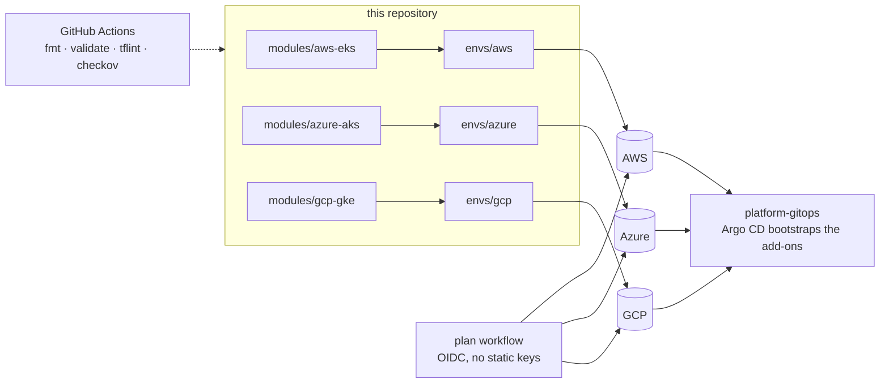

# multicloud-k8s-terraform

[](https://github.com/Engdarwish2019/multicloud-k8s-terraform/actions/workflows/ci.yml)


The same Kubernetes platform baseline on **AWS (EKS)**, **Azure (AKS)** and **Google Cloud (GKE)**,
written as three Terraform modules with matching inputs. Each cluster gets private nodes, a
restricted API endpoint, workload identity, a system node pool and a GPU node pool that scales
from zero. It is the infrastructure layer for [platform-gitops](https://github.com/Engdarwish2019/platform-gitops).

## One baseline, three clouds

| Control | EKS | AKS | GKE |
|---|---|---|---|
| Private nodes, egress via NAT | VPC module, NAT gateway | VNet + NSG, Azure CNI overlay | Private cluster, Cloud NAT |
| API access restricted | `public_access_cidrs` | `authorized_ip_ranges` | Master authorized networks |
| Identity for pods | Pod Identity agent + IRSA (OIDC) | Workload Identity (OIDC issuer) | Workload Identity |
| Human access | EKS access entries (`API` mode) | Entra ID + Azure RBAC, local accounts off | IAM |
| Network policy | VPC CNI | Cilium dataplane | Dataplane V2 |
| Secrets / encryption | KMS envelope encryption (module default) | Key Vault CSI driver, encryption at host | Shielded nodes, secure boot |
| Audit and logs | Control plane logs: api, audit, authenticator | Container Insights (Log Analytics) | Cloud Logging + Managed Prometheus |
| Upgrades | Managed node groups | Auto upgrade `patch` + node image channel | Release channel `REGULAR` |
| Supply chain | | Azure Policy add-on, image cleaner | Binary Authorization, security posture |
| GPU pool | `AL2023_x86_64_NVIDIA`, tainted | `Standard_NC4as_T4_v3`, tainted | `nvidia-tesla-t4`, driver auto-install |

Every module refuses `0.0.0.0/0` for the API (`api_allowed_cidrs` validation).



## Usage

```bash
cd envs/aws            # or envs/azure, envs/gcp
cp terraform.tfvars.example terraform.tfvars
# set api_allowed_cidrs to your public IP, for example ["203.0.113.10/32"]
terraform init
terraform apply
$(terraform output -raw kubeconfig_command)
kubectl get nodes
```

GPU nodes stay at zero until you raise `gpu_node_count` (or the autoscaler adds them for a pod
that requests `nvidia.com/gpu`). GPU pools are tainted, so only workloads that tolerate the taint
land there.

Cloud-specific notes:

- **Azure**: encryption at host needs the `EncryptionAtHost` feature registered on the subscription
  (`az feature register --namespace Microsoft.Compute --name EncryptionAtHost`). GPU VM quota is
  usually zero on new subscriptions.
- **GCP**: enable the `container`, `compute` and `binaryauthorization` APIs first. T4 capacity
  differs per zone; set `gpu_zones` accordingly.

## Tests

Every module has `terraform test` files (`modules/*/tests/`) that run with **mocked providers**,
so they need no cloud account and run on every push:

| Module | Pinned by the tests |
|---|---|
| `azure-aks` | Local accounts off and Azure RBAC (Entra ID only), API limited to the allowed CIDRs, Cilium network policy, workload identity, encryption at host on every pool, system pool for critical add-ons only, tainted and labelled GPU pool |
| `gcp-gke` | Private nodes, master authorized networks, Workload Identity, Binary Authorization enforced, Dataplane V2, shielded nodes, no legacy ABAC or client certificates, GKE metadata server and secure boot on every pool, deny-all ingress firewall |
| `aws-eks` | One private subnet per zone carved from the VPC CIDR, cluster name and Kubernetes version |
| all | The API is rejected if it is open to `0.0.0.0/0` or the allowlist is empty |

Each assertion was checked to fail when the setting it guards is weakened.

```bash
cd modules/azure-aks && terraform init -backend=false && terraform test
```

## Azure DevOps pipeline

[`azure-pipelines/aks.yml`](azure-pipelines/aks.yml) runs the AKS environment on Azure DevOps:

1. **Validate** (every pull request): `fmt`, `validate` and the offline tests.
2. **Plan** (main): signs in through a **workload identity federation** service connection (OIDC,
   no client secret), uses remote state in Azure Storage and saves the plan together with the
   provider lock file as a pipeline artifact.
3. **Apply**: a deployment job on the `aks-lab` environment waits for its **approval check**,
   then applies exactly the reviewed plan.

Reusable step templates install a checksum-verified Terraform and wrap the OIDC sign-in and the
backend, so plan and apply cannot drift apart. The backend is added by the pipeline only
(`backend_override.tf`), so local runs need no state account. Setup: create the service
connection `sc-azure-wif`, the variable group `aks-terraform` (state account, container,
`API_ALLOWED_CIDRS`) and the `aks-lab` environment with an approval.

## CI and security

| Workflow | What it does |
|---|---|
| `ci.yml` | `terraform fmt`, `terraform validate` for each cloud, `terraform test` for each module, `tflint`, `checkov` (SARIF to code scanning), `gitleaks`, and the Azure DevOps pipeline checked against Microsoft's pipeline schema |
| `plan.yml` | Manual `terraform plan` against a real account using GitHub OIDC: AWS IAM role, Azure federated credential, GCP Workload Identity Federation. No cloud keys stored in GitHub. |

Checkov findings that are accepted on purpose are skipped inline with the reason next to the
resource (for example GKE's legacy `network_policy` block, which conflicts with Dataplane V2).

## Layout

```text
modules/
  aws-eks/      VPC + EKS (terraform-aws-modules), add-ons incl. metrics-server, system and GPU node groups
  azure-aks/    RG, VNet + NSG, Log Analytics, identity, AKS, GPU node pool
  gcp-gke/      VPC, firewall baseline, Cloud NAT, node SA, GKE, system and GPU pools
  */tests/      terraform test files with mocked providers
envs/
  aws/ azure/ gcp/   root modules with providers, variables and example tfvars
azure-pipelines/     Azure DevOps pipeline (validate, plan, approved apply) and step templates
```

## License

MIT
